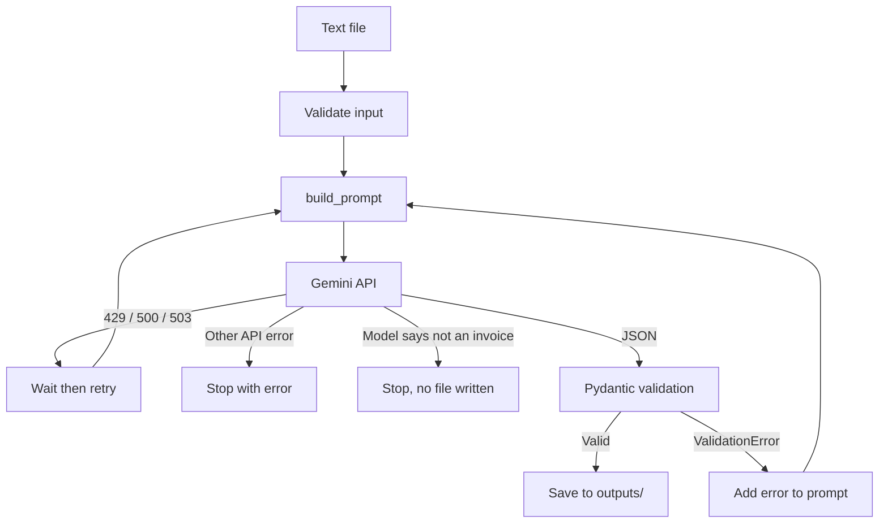

# Task 1: Structured LLM Prompt Pipeline & JSON Extractor

Extracts structured data from unstructured invoice text using the Google Gemini
API then checks the result with Pydantic. If the output is invalid, the
validation error is fed back to the model and it tries again (up to 3 attempts).
If the document is not an invoice, the program says so instead of inventing data.

## How it works

**Data flow**
```
text file -> build_prompt() -> Gemini API -> JSON -> Pydantic validation -> Invoice -> outputs/*.json
                                                          | (fails)
                                              retry with the error fed back (max 3)
```

**Control flow**


1. **Prompt**: rules + JSON schema + three few shot examples (two invoices and one non invoice) + the document.
2. **Constrain**: JSON mode (`response_mime_type`) and `temperature=0`.
3. **Verify**: Pydantic checks types, formats and business rules.
4. **Recover**: a validation failure sends the error text into the next prompt; rate limits (429/500/503) wait with exponential backoff; other API errors (bad key, bad model name) stop immediately; a non invoice is rejected without retrying.

## Project structure

```
task_1_llm_pipeline_&_json_extractor/
├── extractor.py         # CLI entry point: read, call API, validate, retry, save
├── schemas.py           # Pydantic models + validators
├── prompts.py           # prompt template and few shot examples
├── test_schemas.py      # offline tests for the schema (no API key needed)
├── test_extractor.py    # offline tests for the rejection detector
├── samples/             # input documents (fake data)
├── outputs/             # extracted JSON results
└── README.md
```

## Setup

```bash
pip install -r requirements.txt
cp .env.example .env        # Windows: copy .env.example .env
# edit .env and set GEMINI_API_KEY=<your key from Google AI Studio>
```

Optional: set `GEMINI_MODEL` in `.env` to change the model (default `gemini-2.5-flash`).

## Usage

```bash
python extractor.py samples/invoice1.txt
```

The result is printed and saved to `outputs/<file name>.json`.

## Example

**Input** (`samples/invoice1.txt`):
```
Rinku Web Services Pvt. Ltd
Invoice No: INV-2025-7882
Date: 5th Apr 2025
Billed to: Das Pharmacy

Web hosting (annual plan)     1 X 12,000.00
Domain renewwal (.com)        2 X 850.00
Total due: INR 13700.00
```

**Output** (`outputs/invoice1.json`):
```json
{
  "invoice_number": "INV-2025-7882",
  "date": "05-04-2025",
  "vendor_name": "Rinku Web Services Pvt. Ltd",
  "customer_name": "Das Pharmacy",
  "items": [
    {
      "description": "Web hosting (annual plan)",
      "quantity": 1.0,
      "unit_price": 12000.0
    },
    {
      "description": "Domain renewwal (.com)",
      "quantity": 2.0,
      "unit_price": 850.0
    }
  ],
  "tax_amount": null,
  "discount_amount": null,
  "total_amount": 13700.0,
  "currency": "INR"
}
```

The spelling "renewwal" is in the sample file. The model copied it as written because the prompt says not to alter the document's text.

## Validation rules

| Rule | Where | Why |
|---|---|---|
| Date must be a real `DD-MM-YYYY` date | `field_validator` | A regex alone accepts `31-02-2025` |
| `quantity > 0`, `unit_price >= 0` | `Field` constraints | Rejects nonsense values |
| At least one line item | `min_length=1` | An empty list can't pass as an invoice |
| Currency is a 3-letter code, not `XXX` | regex + `field_validator` | An early run returned `1.0` and a later one returned `XXX` |
| `invoice_number` and `vendor_name` can't be placeholders like "UNKNOWN" | `field_validator` | Stops the model inventing filler values to get past validation |
| Items + tax - discount = total (within 0.01) | `model_validator` | Catches misread numbers |
| Model answers `{"error": "not_an_invoice"}` | `is_rejection()` | A non invoice is rejected, never retried |

Run the tests with `pip install pytest` then `pytest -v`. All 10 tests pass and none of them call the API.

## Results on sample documents

| Sample | What it tests | Attempts | Result |
|---|---|---|---|
| invoice1 | Baseline: clear layout, INR, two line items | 1 | Correct. Total 13,700 matches 12,000 + 2 x 850 |
| invoice2 | Freelance-style invoice with no customer name, USD | 1 | Correct. `customer_name` is `null`, not invented. Only one line item was extracted, so check it against the source |
| invoice3 | Euro currency, a different date style | 1 | Correct. Currency `EUR`, total 60 matches 2 x 30 |
| invoice4 | Vendor name in capitals, decimal price, letters in the invoice number | 1 | Correct. 199.99 and `US-902` kept exactly |
| invoice5 | Not an invoice | 1 | Rejected: `The document does not look like an invoice`. No output file written |

## Retry loop in action

This is the real log from an early version of the project, run on `invoice5.txt`, a document that is not an invoice. The schema had no way to say "not an invoice", so required fields were mandatory.

```
WARNING | Attempt 1 failed validation: 5 validation errors for Invoice
invoice_number  Input should be a valid string [input_value=None]
vendor_name     Input should be a valid string [input_value=None]
items           Input should be a valid array [input_value=None]
total_amount    Input should be a valid number [input_value=None]
currency        Input should be a valid string [input_value=None]
WARNING | Attempt 2 failed validation: 1 validation error for Invoice
items.0.quantity  Input should be greater than 0 [input_value=0]
INFO | Attempt 3 succeeded
```

Attempt 1 was the honest answer: `null` everywhere. The retries pushed the model to
fill every field anyway. By attempt 3 it returned `"UNKNOWN"`, currency `"XXX"` and
a fake line item, and validation passed. **Passing validation did not mean the data
was true.**

**Fix:** the prompt now tells the model to answer `{"error": "not_an_invoice"}` for
non invoices (with a worked example), the extractor stops immediately on that answer
and the schema rejects placeholder values as a backup. Current result:

```
ERROR | Could not process invoice5.txt: The document does not look like an invoice
```

## Design decisions

- **Schema generated into the prompt** from `Invoice.model_json_schema()`, so the schema and prompt can't drift apart.
- **`temperature=0`**, because extraction should be repeatable, not creative.
- **Optional fields** (`customer_name`, `tax_amount`, `discount_amount`), so the model isn't pushed to invent values.
- **An honest way out.** A required field schema with no refusal path caused the fabricated output shown above.
- **Date format DD-MM-YYYY** to match Indian invoices. ISO (`YYYY-MM-DD`) would be better for databases.
- **Separate failure types, separate responses**: a bad answer gets a corrective retry, API trouble gets a wait and a bad request or a non invoice stops immediately.
- **No `response_schema` in the API call.** The Google SDK could not convert constraints like `gt=0` and it crashed before sending anything. An early version wrongly treated that crash as a bad answer and retried three times. Now the schema lives in the prompt and Pydantic enforces every rule locally.

## Known limitations

- `total_amount` uses `float`. Production financial code should use `Decimal`.
- Validators check that the numbers agree with each other not that they are true. If the model silently drops a line item and the document's stated total matches the remaining items, nothing flags it.
- If the document itself is inconsistent (the stated total doesn't match its items), retrying can't fix it. A real system would flag it for human review.
- Only plain text input. No PDF or image parsing.
- Only invoices in the schema's structure are supported. Other document types need their own schema.