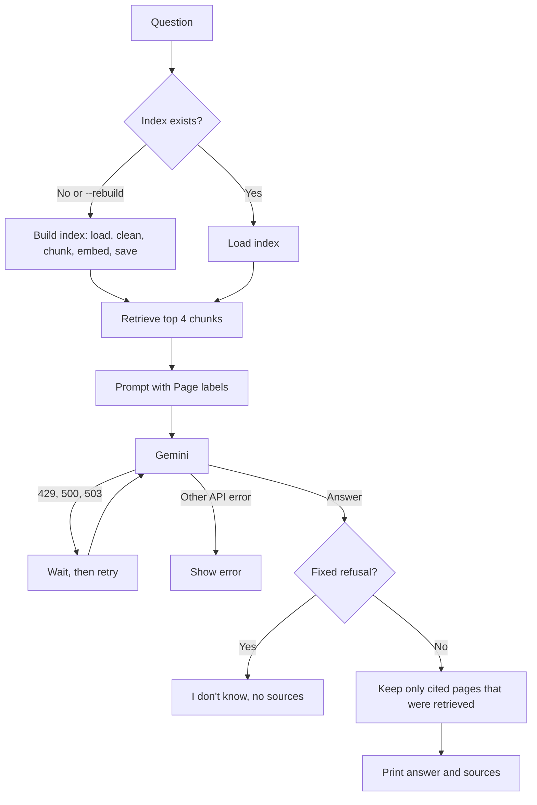

# Task 2: Document Q&A Assistant (RAG)

Answers questions about a PDF using only its content and cites the page each
answer came from. If the document doesn't contain the answer, it says so
instead of guessing. Built with a local embedding model, ChromaDB and Gemini.

Demo document: *Ramayana for Children* (Swami Raghaveshananda, 48 pages).


## How it works

**Data flow**
```
INDEXING (once)
PDF -> pages -> clean text -> chunks -> embeddings -> ChromaDB (chroma_db/)

QUERYING (each question)
question -> embedding -> top 4 chunks -> grounded prompt -> Gemini -> answer + page citations
```

**Control flow**
```
main()
  ├─ index exists and no --rebuild?  load_index()
  │   else build_index():  delete old index -> load pages -> split into chunks
  │                        -> drop tiny chunks -> embed -> save to chroma_db/
  ├─ read GEMINI_API_KEY               missing -> clear error, exit
  └─ question given?  ask once : loop on input until "quit"
        answer_question()
          ├─ retrieve top 4 chunks, label each with its [Page N]
          ├─ call Gemini (temperature 0, "use only this context")
          │     ├─ 429 / 500 / 503  -> wait 2s, 4s, retry (max 3)
          │     └─ other API error  -> stop, show message
          ├─ answer is the fixed refusal?  -> "I don't know", no sources
          └─ otherwise keep only cited pages that were really retrieved -> print answer + Sources
```



1. **Load** (`ingest.py`): one document per page, tagged with the *printed* page number, not the PDF index.
2. **Chunk** (`chunking.py`): `RecursiveCharacterTextSplitter`, 1500 characters with 200 overlap.
3. **Embed and store** (`vector_store.py`): `BAAI/bge-small-en-v1.5` runs locally (no API quota) and ChromaDB saves the index to disk.
4. **Answer** (`rag.py`): the top 4 chunks go to Gemini with strict rules, "use only this context, otherwise say I don't know".
5. **Cite**: pages cited by the model are checked against the pages actually retrieved and invented pages are dropped.

## Project structure

```
task_2_rag_assistant/
├── data/              # put your PDF here (not committed)
├── ingest.py          # PDF -> cleaned page Documents
├── chunking.py        # pages -> overlapping chunks
├── vector_store.py    # embeddings + ChromaDB
├── rag.py             # retrieval + grounded answer + citations
├── app.py             # command-line interface
└── requirements.txt
```

## Setup

```bash
pip install -r requirements.txt
```

Create a `.env` file in this folder with `GEMINI_API_KEY=<your key from Google AI Studio>`.
Optional: `GEMINI_MODEL` to change the model (default `gemini-2.5-flash`).

The PDF is copyrighted and is not in this repo. Put your own PDF in `data/` and set
`PDF_PATH` in `ingest.py`. `PAGE_OFFSET` and `SKIP_INDEXES` in `ingest.py` are specific
to the demo book (cover and drawing pages, printed page = PDF index - 1); change them
for another PDF.

## Usage

```bash
python app.py "Why did Kaikeyi ask for two boons?"   # one question
python app.py                                         # interactive chat
python app.py --rebuild                               # re-index the PDF first
```

## Results

| Question | Answer | Source |
|---|---|---|
| Why did Kaikeyi ask for two boons? | Manthara poisoned her mind, making her fear that Kausalya would take revenge once Rama was crowned; Manthara then suggested the boons | page 10 |
| Who is Sampati? | Jatayu's elder brother, a son of Aruna, the god of dawn; a huge eagle with broken wings | page 27 |
| Who stopped Ravana from killing Hanuman? | I don't know based on the provided document. | none |
| Who won the 2018 football World Cup? | I don't know based on the provided document. | none |

The third question is answered in the book (printed page 33) but that page's text was lost in the PDF's OCR
and excluded at ingest, so the system correctly says it doesn't know instead of using outside knowledge.

## What I measured

**Chunk size.** The answer to "why did Kaikeyi ask for two boons" needs two passages about 1,000 characters apart.

| chunk_size | chunks | Both passages in one chunk? |
|---|---|---|
| 300 | 334 | No |
| 800 | 127 | No |
| 1500 | 76 | Yes |

**Distance is not an answerability signal.** The Kaikeyi question (answer present) scored 0.447 and the Hanuman
question (answer absent) scored 0.450. Similarity only says a chunk is on the same topic, so whether the answer
exists is decided by the model's grounded prompt not a distance cutoff.

## Design decisions

- **Local embeddings**, so indexing makes no API calls and isn't limited by free tier rate limits.
- **`bge-small-en-v1.5` over the common MiniLM default**: it reads up to 512 tokens so 1500 character chunks are not truncated.
- **Chunking per page** keeps every chunk's page citation exact, at the cost of cutting stories at page boundaries.
- **Cleaning before chunking**: removed the running page header, rejoined words split across lines and dropped image-only pages.
- **Fixed refusal sentence**, so the code can detect it and show no sources for a refusal.
- **Citation cross-check**: a page the model cites but that was not retrieved is discarded.
- **Plain retrieval plus one model call** instead of LangChain's `RetrievalQA`, which is deprecated.
- **Rebuilding deletes the old index first**, so no duplicate chunks.

## Known limitations

- The PDF is OCR output: some pages have garbled text and one story page (printed page 33) was lost entirely.
- Rejoining hyphenated line breaks can glue genuine hyphenated words (`god-like` becomes `godlike`).
- Chunks never cross page boundaries, so a passage that spans two pages is split.
- Answers depend on the Gemini API being reachable and within its rate limits.
- Tested on one document and a handful of questions not a full evaluation set.