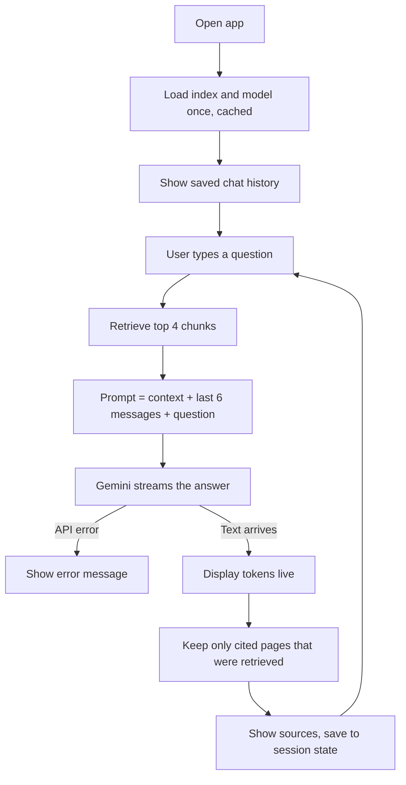

# Task 4: Interactive Streamlit Chatbot

A browser chat interface over the Task 2 RAG pipeline: streaming answers, chat
history, page citations and a clear chat button. It reuses the Task 2 modules
instead of copying them.


## How it works



- **`st.session_state.messages`** keeps the conversation, because Streamlit reruns the script on every interaction.
- **`@st.cache_resource`** loads the embedding model and ChromaDB index once per server.
- **`st.write_stream`** shows text as Gemini produces it then the full text goes through the same citation check as Task 2.
- **Memory** is the last 6 messages, included in the prompt so follow ups make sense.

## Setup

This app imports the Task 2 code so the `task_2_rag_assistant/` folder must be present.

```bash
pip install -r requirements.txt
```

1. Put a PDF in `task_2_rag_assistant/data/` (see the Task 2 README) and create `task_2_rag_assistant/.env` with `GEMINI_API_KEY=...`.
2. The first run builds the index automatically if `chroma_db/` doesn't exist.

```bash
streamlit run streamlit_app.py
```

## Known limitations

- Retrieval searches on the latest question only, so a vague follow up ("what happened next?") may retrieve poorly. Rewriting the question with the chat history before searching would fix this.
- History is kept per browser session and is lost on refresh.
- Streaming restarts the whole answer if the API fails halfway.
- Inherits Task 2's limits: OCR errors in the PDF and one lost page.